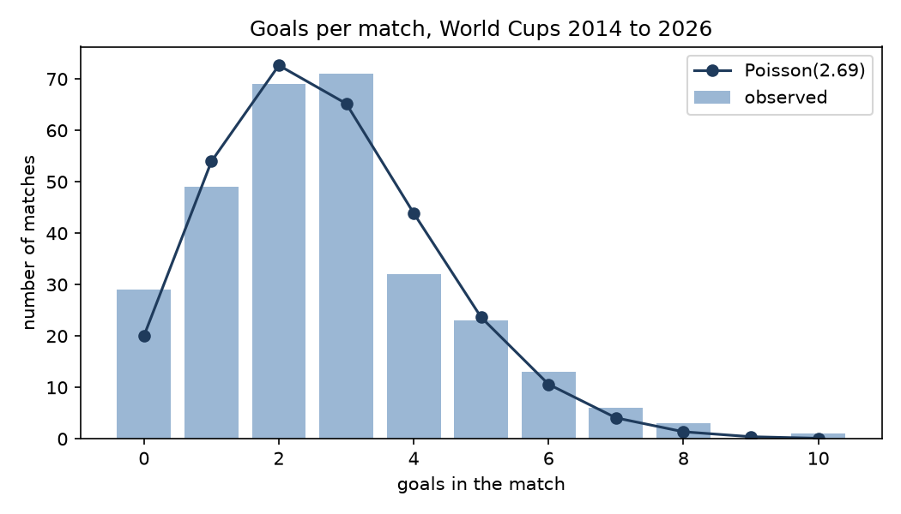
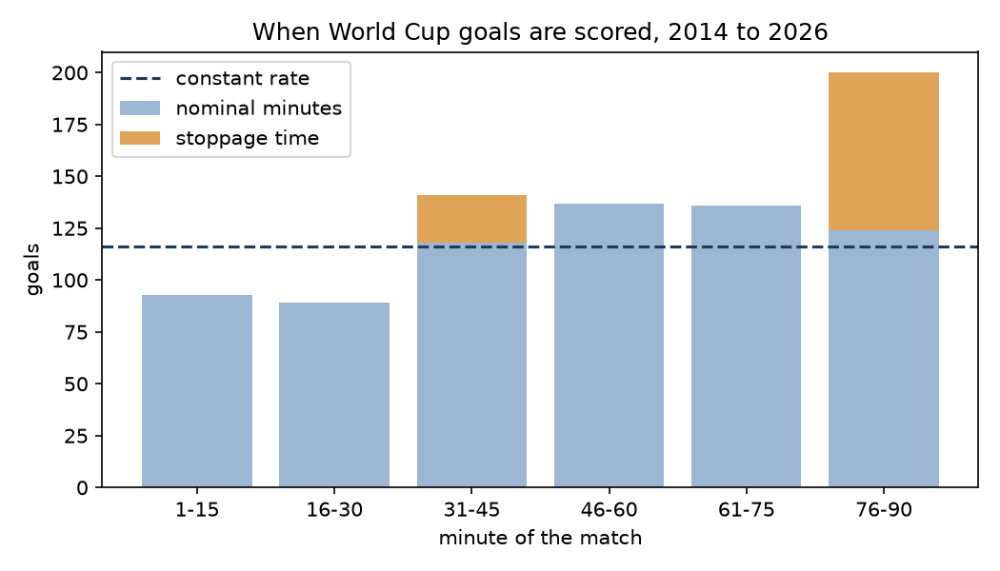
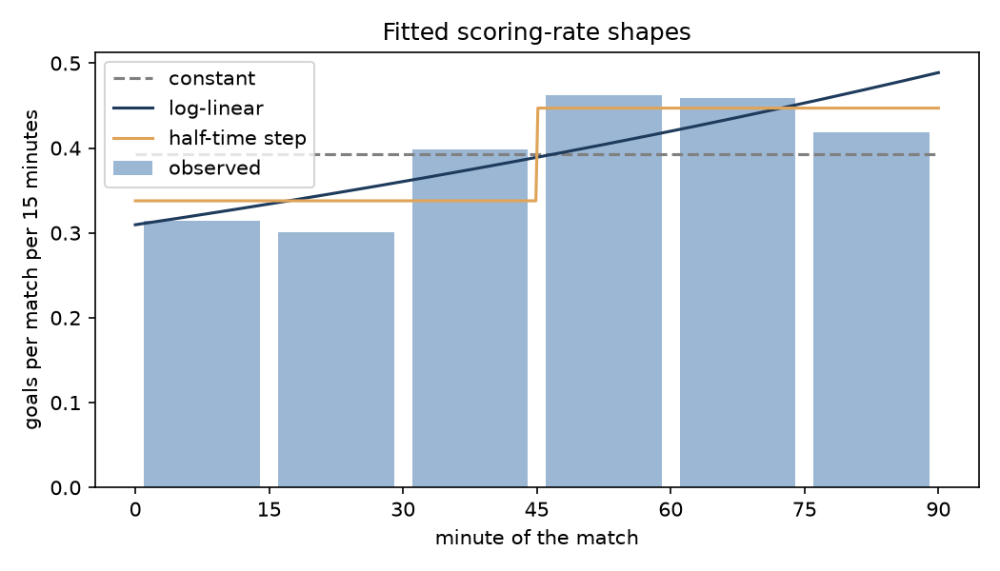
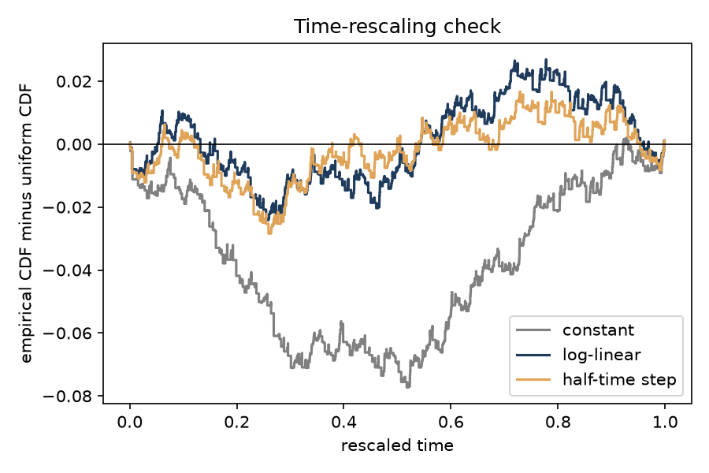
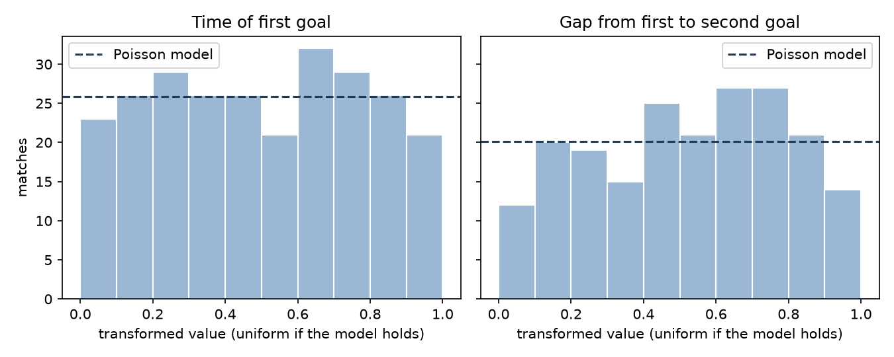

# Are World Cup goals a Poisson process?

A statistical test of the standard model for football scoring, using the minute of every goal at the 2014, 2018, 2022 and 2026 men's World Cups: 296 matches and 820 goals.

**Short answer:** not with a constant rate, but very nearly with a rate that rises through the match. Scoring is about 1.6 times faster at minute 90 than at kick-off, and once that is accounted for, goal times within a match look memoryless.

## Findings

### 1. Goals per match are close to Poisson, but overdispersed

The mean is 2.69 goals per match and the variance is 3.25. A dispersion test rejects equality (p = 0.008); a chi-square goodness-of-fit test narrowly does not (p = 0.054). There are too many goalless matches and too many with six or more, which is what a mixture of matches with different scoring rates produces.



### 2. The scoring rate is not constant within a match

For a constant-rate Poisson process, goal times are uniform over the match once you condition on how many there were, whatever each match's own rate is. We find that they are not: a chi-square test across six 15-minute periods gives p = 0.002 and a Kolmogorov-Smirnov test on the goal times gives p = 0.0003. The second half has about 1.3 times as many goals as the first.



### 3. A rate that rises with time fits

A non-homogeneous Poisson process with a log-linear rate, fitted by maximum likelihood, puts the rate at minute 90 at 1.58 times the rate at kick-off (95% interval 1.22 to 2.04). It beats the constant model on a likelihood-ratio test (p = 0.0005). A step up at half-time fits about equally well.

The time-rescaling theorem furthers the adequacy of this model: on a clock run at the speed of the fitted rate, the goal times are consistent with uniform (KS p = 0.68, against p = 0.0003 on the ordinary clock). Fitted on 2014 to 2022 and applied to 2026 without refitting, the model still holds (p = 0.33).




### 4. No evidence that a goal changes what happens next

On the rescaled clock, the time of a match's first goal and the gap from its first goal to its second both match the Poisson prediction (KS p = 0.93 and p = 0.11). 



## Data and how it was handled

Goal minutes come from [openfootball/worldcup.json](https://github.com/openfootball/worldcup.json).

- **Regulation time only.** The 24 goals scored in extra time are excluded, since only 27 matches went to extra time.
- **Stoppage time is kept out of the timing tests.** The data records a goal at "90+4" but not how long stoppage time lasted, so the amount of playing time those goals came from is unknown. Notebooks 2 to 4 use the 697 goals scored in the 90 nominal minutes. The 99 regulation goals in stoppage time are reported separately. 
- **Whole minutes.** A goal in minute m is treated as falling uniformly in the interval (m - 1, m], with a fixed random seed.

## Run it

```bash
git clone https://github.com/ayanapatidar/goals-as-poisson.git
cd goals-as-poisson
python3 -m venv .venv && source .venv/bin/activate
pip install -r requirements.txt
git clone --depth 1 https://github.com/openfootball/worldcup.json.git data/worldcup.json
python src/load.py data/worldcup.json
```

Then run the notebooks in `notebooks/` in order.

| Notebook | Question |
| --- | --- |
| `01_goals_per_match` | Are goals per match Poisson distributed? |
| `02_goal_times` | Is the scoring rate constant through a match? |
| `03_time_varying_rate` | What rate fits, and is it adequate? |
| `04_memory` | Does a goal change what happens next? |

## Limitations

- Four tournaments give about 700 usable goal times. That is enough to reject a constant rate, but not enough to choose between a smooth rise and a half-time step.
- Teams are not modelled. Each match has its own overall rate, but the two sides are pooled, so effects that depend on which team scored are invisible here.
- Excluding stoppage time loses about one regulation goal in eight.

## Reference

Brown, Barbieri, Ventura, Kass and Frank (2002), "The time-rescaling theorem and its application to neural spike train data analysis", *Neural Computation* 14(2).
